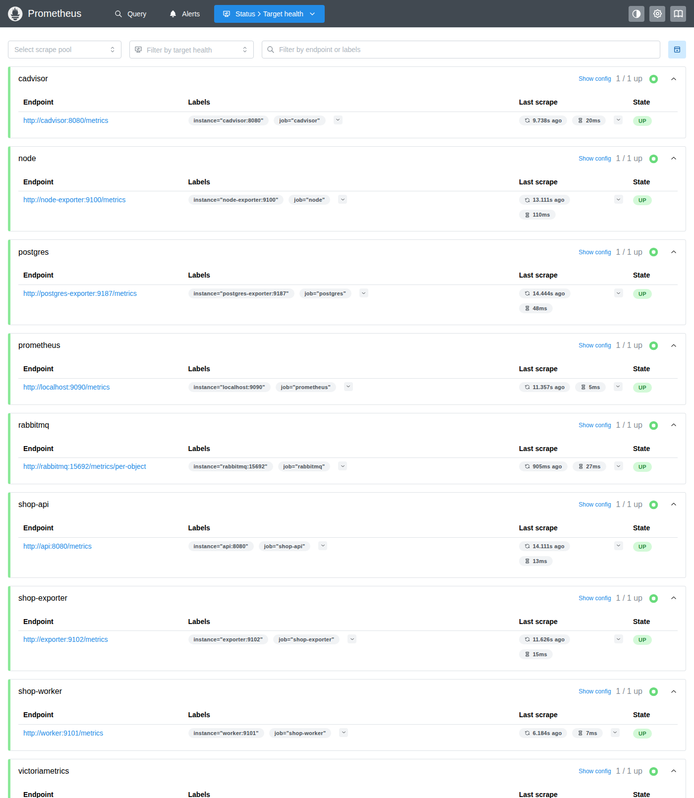

# Метрики и мониторинг

Стенд собирает метрики из трёх источников:

1. **Встроенные метрики API и Worker.** Их считает код приложения клиентской библиотекой Prometheus
   (`io.prometheus:prometheus-metrics-core`).
2. **Готовые метрики инфраструктуры:** node_exporter, cAdvisor, postgres_exporter и плагин rabbitmq_prometheus.
3. **Собственный exporter** (модуль `shop_exporter`). Он переводит JSON из `GET /internal/stats` в метрики.

Prometheus забирает метрики со всех источников и копирует их в VictoriaMetrics через `remote_write`.

```
Пользователь ──HTTP──→ API ──→ PostgreSQL
                        └───→ RabbitMQ ──→ Worker

Prometheus ──GET /metrics──→ API, Worker, собственный exporter,
                             node_exporter, cAdvisor, postgres_exporter, RabbitMQ
Собственный exporter ──GET /internal/stats──→ API
Prometheus ──remote_write──→ VictoriaMetrics
```

Запуск стенда описан в [README](../README.md#запуск-стенда-в-docker).

## Цели Prometheus

Конфигурация: [`monitoring/prometheus/prometheus.yml`](../monitoring/prometheus/prometheus.yml).

| job               | Адрес                               | Что отдаёт                                                     |
|-------------------|-------------------------------------|----------------------------------------------------------------|
| `shop-api`        | `api:8080/metrics`                  | HTTP-метрики и счётчик созданных заказов (код API), метрики JVM |
| `shop-worker`     | `worker:9101/metrics`               | Время обработки заказа (код Worker), метрики JVM               |
| `shop-exporter`   | `exporter:9102/metrics`             | Количество заказов по статусам из `GET /internal/stats`        |
| `node`            | `node-exporter:9100/metrics`        | Хост: CPU, память, диски                                       |
| `cadvisor`        | `cadvisor:8080/metrics`             | Контейнеры: CPU, память, сеть                                  |
| `postgres`        | `postgres-exporter:9187/metrics`    | PostgreSQL: соединения, транзакции                             |
| `rabbitmq`        | `rabbitmq:15692/metrics/per-object` | RabbitMQ: очереди, потребители, соединения                     |
| `prometheus`      | `localhost:9090/metrics`            | Сам Prometheus, в том числе состояние `remote_write`           |
| `victoriametrics` | `victoriametrics:8428/metrics`      | Сама VictoriaMetrics                                           |



## Метрики API

Считаются в коде API в момент обработки запроса. Код: [`HttpMetricsFilter`](../shop_api/src/main/java/com/example/edu_shop/api/metrics/HttpMetricsFilter.java)
и [`OrderService`](../shop_api/src/main/java/com/example/edu_shop/api/order/OrderService.java).

| Метрика                         | Тип       | Метки                     | Когда обновляется                                    |
|---------------------------------|-----------|---------------------------|------------------------------------------------------|
| `http_requests_total`           | Counter   | `method`, `route`, `status` | +1 после каждого HTTP-запроса                       |
| `http_request_duration_seconds` | Histogram | `method`, `route`, `status` | После каждого HTTP-запроса записывается его длительность |
| `shop_orders_created_total`     | Counter   | —                         | +1 после успешного `POST /orders`                    |

- В `route` попадает шаблон пути (`/orders/{id}`), а не сам путь (`/orders/42`). Иначе каждый заказ порождал бы
  новый временной ряд.
- Запросы на несуществующие пути попадают в `route="/**"`: этот шаблон у обработчика статических ресурсов
  Spring Boot, который принимает любой путь и отвечает 404.
- Если Spring MVC отклонил запрос ещё при поиске обработчика, шаблона пути нет и `route="UNKNOWN"`. Например,
  путь существует, но метод не тот: `POST /health` → 405. Необработанное исключение считается как `status="500"`.
- Бакеты гистограммы стандартные для клиентов Prometheus: от 5 мс до 10 с.
- В HTTP-метриках учитываются и технические запросы. Docker проверяет `/health` каждые 5 с, Prometheus
  забирает `/metrics`, а exporter вызывает `/internal/stats` каждые 15 с. Чтобы оставить только пользовательские
  запросы, добавьте в запрос фильтр `route=~"/orders.*"`.
- Если RabbitMQ недоступен, `POST /orders` завершается ошибкой, и заказ не учитывается в `shop_orders_created_total`.

Статусы заказов (NEW/PROCESSING/DONE) API в `/metrics` намеренно не отдаёт: их создаёт только собственный exporter.

## Метрика Worker

Считается в коде Worker. Код: [`OrderProcessor`](../shop_worker/src/main/java/com/example/edu_shop/worker/OrderProcessor.java).

| Метрика                                  | Тип       | Когда обновляется                         | Что показывает                                            |
|------------------------------------------|-----------|-------------------------------------------|-----------------------------------------------------------|
| `shop_order_processing_duration_seconds` | Histogram | Когда Worker перевёл заказ в DONE         | Секунды от получения сообщения из RabbitMQ до статуса DONE |

Бакеты от 0,1 с до 60 с. Обработка длится не меньше `PROCESSING_DELAY_MS` (по умолчанию 2 с), поэтому
бакеты крупнее, чем у HTTP-запросов. Если заказ пропущен (его нет в базе или он уже DONE), время не записывается.

## Метрики собственного exporter

Exporter ([`ShopStatsCollector`](../shop_exporter/src/main/java/com/example/edu_shop/exporter/ShopStatsCollector.java))
не опрашивает API по расписанию. Он вызывает `GET /internal/stats` в момент, когда Prometheus запрашивает
у него `/metrics`, поэтому значения всегда свежие.

| Поле из `/internal/stats` | Что делает exporter                    | Метрика (Gauge)                           |
|---------------------------|----------------------------------------|-------------------------------------------|
| `orders_new`              | Берёт текущее число                    | `shop_stats_orders_new`                   |
| `orders_processing`       | Берёт текущее число                    | `shop_stats_orders_processing`            |
| `orders_done`             | Берёт текущее число                    | `shop_stats_orders_done`                  |
| `last_processed_at`       | Считает «текущее время − last_processed_at» | `shop_stats_seconds_since_last_processed` |
| —                         | 1, если API ответило, иначе 0          | `shop_stats_up`                           |

- `shop_stats_up` добавлена сверх задания по соглашению для exporter-ов (как `pg_up` у postgres_exporter).
  Если API недоступно, exporter отдаёт только `shop_stats_up 0`, а не последние известные числа.
- Пока ни один заказ не обработан, `last_processed_at` пуст и `shop_stats_seconds_since_last_processed` не отдаётся.

## Готовые метрики инфраструктуры

| Что наблюдаем | Источник                                                | Метрики                                                                                                                   |
|---------------|---------------------------------------------------------|---------------------------------------------------------------------------------------------------------------------------|
| Хост          | node_exporter                                           | `node_cpu_seconds_total`, `node_memory_MemAvailable_bytes`, `node_filesystem_avail_bytes`                                  |
| Контейнеры    | cAdvisor                                                | `container_cpu_usage_seconds_total`, `container_memory_working_set_bytes`, `container_network_receive_bytes_total`, `container_network_transmit_bytes_total` |
| PostgreSQL    | postgres_exporter                                       | `pg_up`, `pg_stat_database_numbackends`, `pg_stat_database_xact_commit`, `pg_stat_database_xact_rollback`                 |
| RabbitMQ      | плагин rabbitmq_prometheus (включён в образе `rabbitmq:4-management`) | `rabbitmq_queue_messages_ready`, `rabbitmq_queue_messages_unacked`, `rabbitmq_queue_consumers`, `rabbitmq_connections` |

- node_exporter работает в контейнере, но видит корень хоста (смонтирован в `/host` только на чтение) и его процессы
  (`pid: host`). Сетевые метрики при этом относятся к сети контейнера, а не хоста.
- У метрик cAdvisor есть метка `container_label_com_docker_compose_service` с именем службы из `docker-compose.yml`
  (`api`, `worker`, ...). Для cAdvisor включён `track_timestamps_staleness`. Без него ряды удалённого контейнера
  видны ещё 5 минут, и после пересоздания контейнера запрос по нему возвращает два ряда.
- RabbitMQ опрашивается по пути `/metrics/per-object`: на `/metrics` значения просуммированы по всем очередям,
  и метки `queue` нет.

Кроме того, API, Worker и exporter отдают метрики JVM и пула соединений (`jvm_*`, `process_*`, `hikaricp_*`).
Их добавляет Micrometer через Spring Boot Actuator. Две встроенные группы метрик Spring отключены, чтобы не было дублей:

- `http_server_requests_seconds`: в API вместо неё есть `http_requests_total` и `http_request_duration_seconds`,
  а к Worker и exporter по HTTP обращается только Prometheus;
- клиентские метрики RabbitMQ в API и Worker: их имена (`rabbitmq_connections` и др.) совпадают с метриками самого брокера.

## Prometheus и VictoriaMetrics

Prometheus хранит данные 2 дня, VictoriaMetrics — 90 дней. Блок `remote_write` в `prometheus.yml` отправляет
в VictoriaMetrics всё, что собрал Prometheus:

```yaml
remote_write:
  - url: http://victoriametrics:8428/api/v1/write
```

VictoriaMetrics понимает PromQL и тот же HTTP API, что и Prometheus, поэтому все запросы ниже работают в обоих.
Проверить, что данные дошли:

- открыть VMUI: http://localhost:8428/vmui;
- или выполнить запрос через HTTP API: `curl -s 'localhost:8428/api/v1/query?query=shop_stats_orders_done'`;
- в Prometheus `prometheus_remote_storage_samples_failed_total` должна оставаться равной 0.

Значения `rate()` в двух системах немного отличаются. VictoriaMetrics не экстраполирует `rate` к границам окна,
а `remote_write` доставляет данные пачками с задержкой в несколько секунд.

## PromQL-запросы

**1. Сколько запросов в секунду получает API?**

```promql
sum(rate(http_requests_total{job="shop-api"}[1m]))
```

`rate` считает прирост счётчика в секунду за последнюю минуту по каждому ряду, `sum` складывает все маршруты и
статусы. Даже без пользователей результат около 0,33 запроса/с: healthcheck Docker (0,2), Prometheus и exporter
(по 0,067). Разбивка по маршрутам: `sum by (method, route) (rate(http_requests_total{job="shop-api"}[1m]))`.

**2. Какой p95 времени ответа `POST /orders`?**

```promql
histogram_quantile(0.95,
  sum by (le) (rate(http_request_duration_seconds_bucket{job="shop-api", method="POST", route="/orders"}[5m])))
```

95% запросов на создание заказа за последние 5 минут выполнились быстрее этого числа секунд. `sum by (le)`
объединяет бакеты всех статусов ответа. `histogram_quantile` интерполирует внутри бакета, поэтому точность оценки
ограничена границами бакетов.

**3. Сколько памяти использует контейнер API?**

```promql
container_memory_working_set_bytes{container_label_com_docker_compose_service="api"} / 1024 / 1024
```

Рабочий набор памяти контейнера API в МиБ: занятая память без кэша, который ядро может освободить.
Обычно именно его сравнивают с лимитом памяти контейнера.

**4. Сколько сообщений сейчас ждут обработки в RabbitMQ?**

```promql
rabbitmq_queue_messages_ready{job="rabbitmq", queue="orders.processing"}
```

Сообщения в очереди Worker-а, которые ещё никто не взял. Если число растёт, Worker не успевает за API.
Взятые, но не подтверждённые сообщения считает `rabbitmq_queue_messages_unacked`: из-за `prefetch: 1` их не больше одного.

**5. Сколько заказов сейчас находятся в PROCESSING?**

```promql
shop_stats_orders_processing
```

Значение приходит из собственного exporter. Worker обрабатывает заказы по одному, поэтому обычно здесь 0 или 1.

**6. Сколько секунд прошло с момента последнего обработанного заказа?**

```promql
shop_stats_seconds_since_last_processed
```

Если заказы есть (`shop_stats_orders_new > 0`), а значение растёт, Worker остановился или завис.
Хорошее условие для алерта.

**7. Сколько соединений открыто к PostgreSQL?**

```promql
sum(pg_stat_database_numbackends{datname="shop"})
```

Число соединений к базе `shop`. Около 20 из них — пулы HikariCP в API и Worker (по 10 соединений), одно —
у postgres_exporter.

Ещё два запроса покрывают метрики Worker и хоста:

```promql
# Среднее время обработки заказа в Worker: чуть больше PROCESSING_DELAY_MS, к задержке добавляются два UPDATE в базе
rate(shop_order_processing_duration_seconds_sum[5m]) / rate(shop_order_processing_duration_seconds_count[5m])

# Загрузка CPU хоста в процентах: доля времени, когда процессоры не простаивали
100 * (1 - avg(rate(node_cpu_seconds_total{mode="idle"}[1m])))
```

## Задержка обработки

Задержку Worker-а можно увеличить без пересборки:

```bash
PROCESSING_DELAY_MS=10000 docker compose up -d worker
```

Если при этом создавать заказы чаще, чем раз в 10 секунд, растут `rabbitmq_queue_messages_ready` и
`shop_stats_orders_new`, а среднее время обработки из `shop_order_processing_duration_seconds` становится
чуть больше 10 секунд.

Задержка у всех заказов одинаковая, поэтому все наблюдения попадают в один бакет гистограммы: при 2 с это
бакет от 2 до 3 с, при 10 с — от 10 до 20 с. `histogram_quantile` считает значения внутри бакета
распределёнными равномерно, поэтому p95 получится у верхней границы бакета: около 2,95 с и 19,5 с.
Время обработки Worker-а точнее показывает среднее `_sum / _count`.

## Вывод

| | Встроенные метрики API/Worker | Готовые метрики инфраструктуры | Собственный exporter |
|---|---|---|---|
| Где рождается метрика | В коде сервиса в момент события: запрос обработан, заказ перешёл в DONE | В готовом exporter-е или плагине, который читает внутреннюю статистику системы (`/proc`, cgroups, `pg_stat_*`, статистику RabbitMQ) | В отдельном сервисе-переводчике в момент запроса Prometheus, из обычного JSON-API |
| Что нужно сделать | Изменить код: подключить клиентскую библиотеку и обновлять метрики | Запустить exporter и добавить цель в Prometheus | Написать адаптер: получить данные и описать, как поля превращаются в метрики |
| Что видно | События и их длительность: Counter, Histogram. Можно считать скорость и перцентили | Состояние ресурсов: CPU, память, соединения, очереди. Бизнес-смысла система не знает | Снимок текущего состояния данных (Gauge): сколько заказов в каждом статусе |
| Ограничения | Нужен доступ к коду. Счётчики живут в памяти процесса и обнуляются при рестарте | Только то, что считает сама система | Видны только значения в моменты опроса. Каждый опрос — дополнительный запрос к API и SQL к базе |

Встроенные метрики точнее всего описывают поведение сервиса, но требуют изменения кода. Готовые exporter-ы
покрывают инфраструктуру без своего кода. Собственный exporter нужен, когда систему нельзя или не хочется менять,
но данные она уже отдаёт в другом формате.
